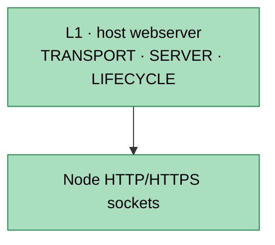
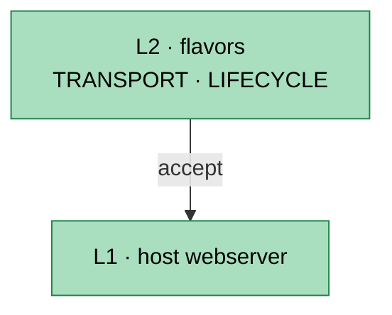
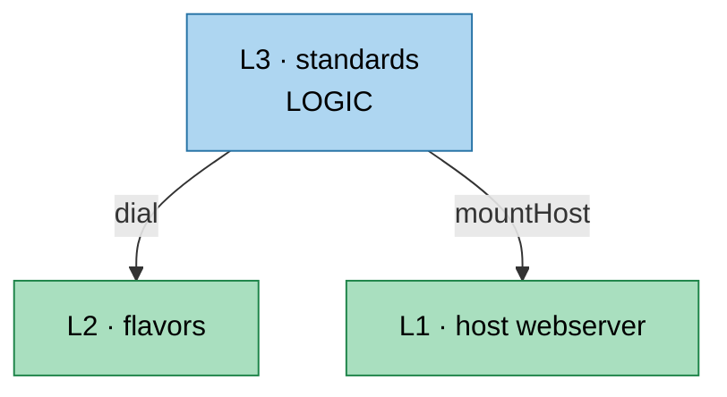
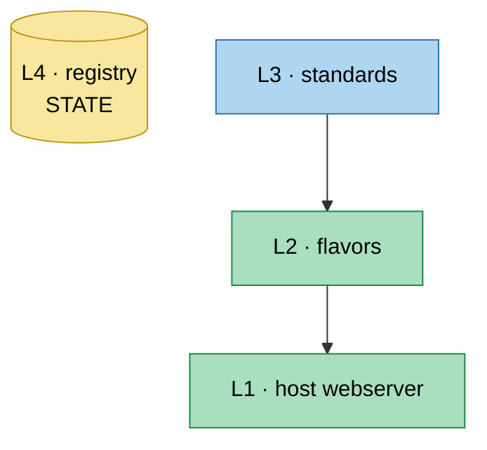
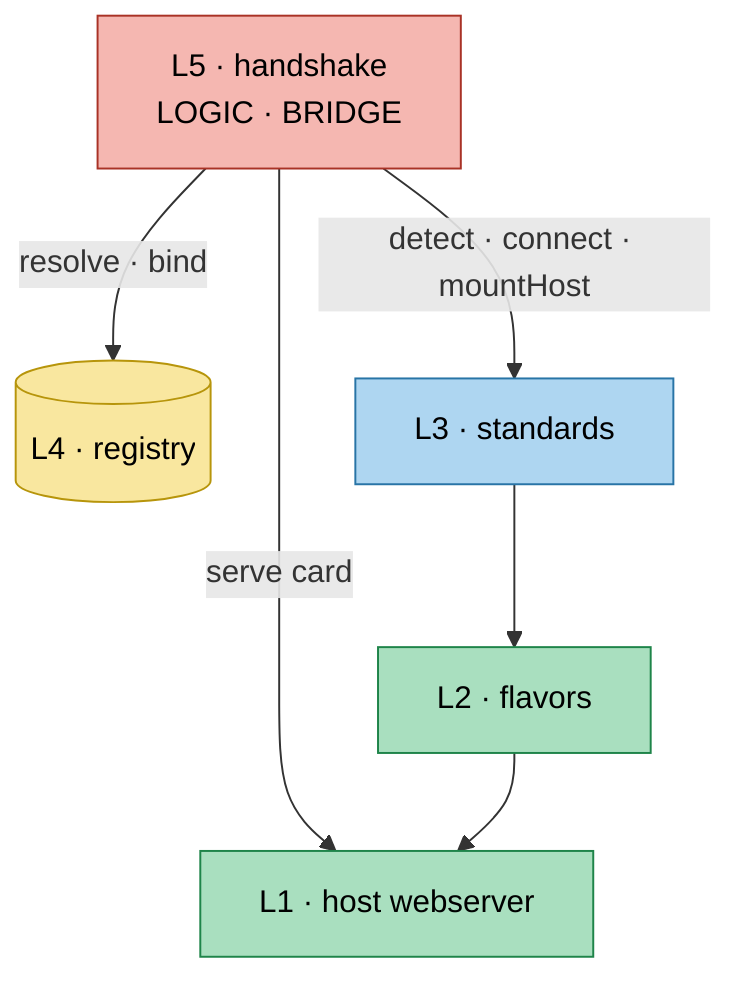
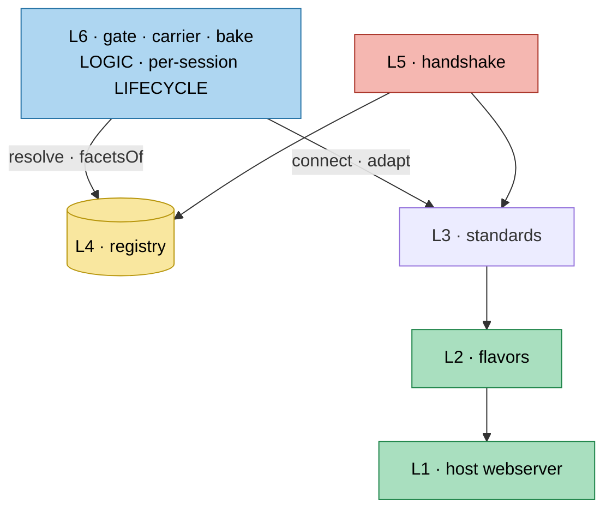
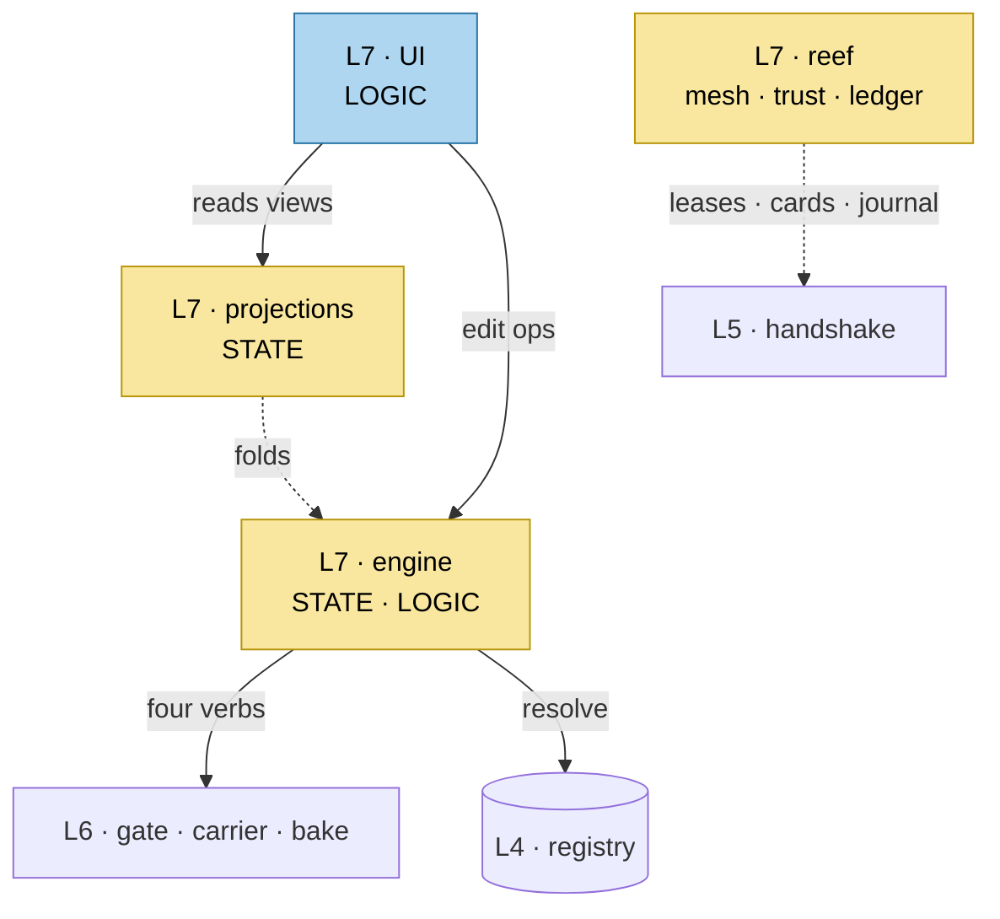
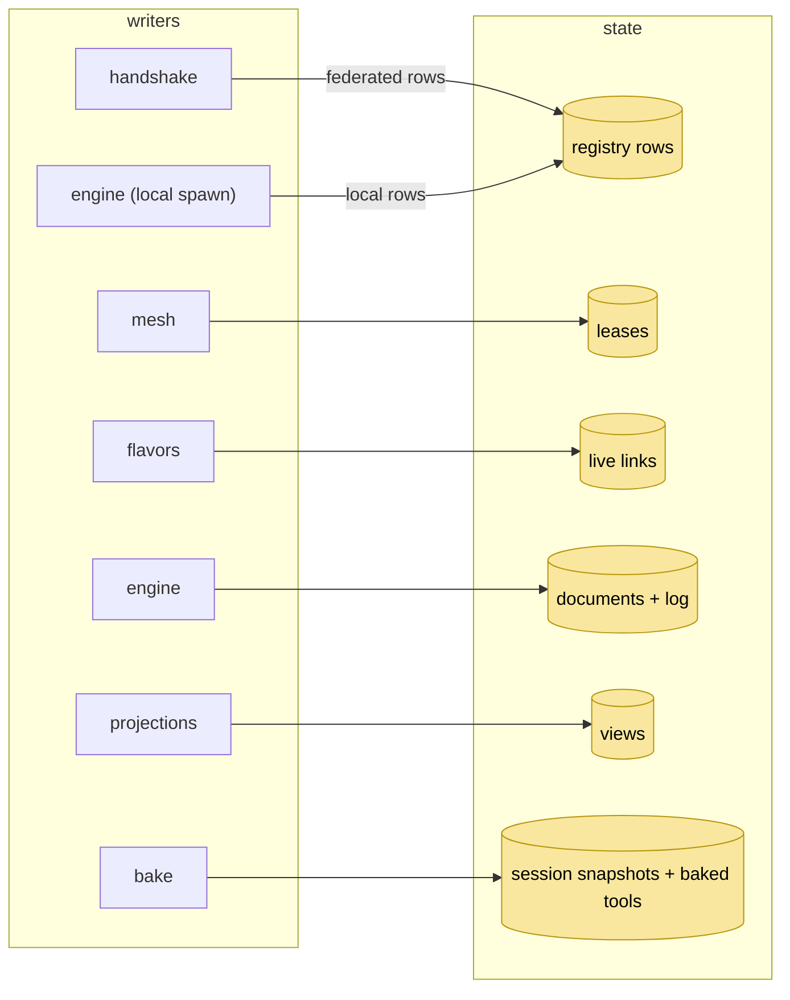
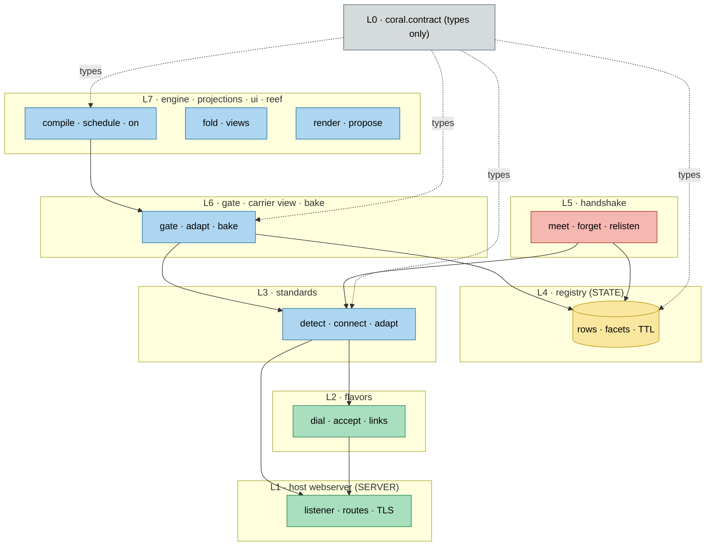
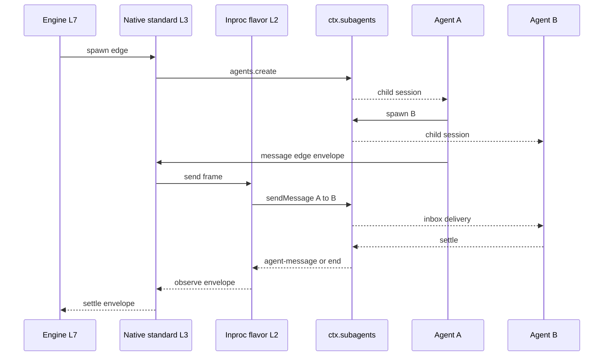

# Agent Note: The Coral and Reef plugin layers — seven runtime layers, a types-only contract, and their API surfaces

Status: proposed

## Problem

The Coral and Reef plane is specified across four proposed Agent Notes and a reference document outside this repository (`Cordises/docs/CORAL-PLUGIN-LAYERS.md`). No in-repo document states the layer membership, the `ctx` service key, the store, and the call direction for every plugin. Without that map a new plugin can land in the wrong layer, call upward, or fork a contract another layer already owns; the out-of-repo reference carries no alternatives and no acceptance criteria, and its type snippets predate the four notes — an `Endpoint` with a `carrier` string, `inproc | ipc | net` flavors, a registry subscribed to lease events, and a `CarrierCapabilities` struct that the standard plane replaces with spec-owned facets.

The call map alone also hides a second question readers keep asking: which plugin owns data, which owns logic, which owns the socket, and which owns a lifecycle. The registry is described as a service but is really a store; a flavor is described as an adapter but really owns the frame loop and the live-link lifecycle; the websocket is split across three layers. The layer list states direction but not role, so the same conceptual questions return. This note adds the role model, the lifecycle inventory, and the transport-ownership table to the same map.

## Proposal

Adopt a types-only contract layer (`coral.contract`, L0), seven runtime layers below the engine, one plugin family per layer, and one rule: **a layer calls only the layers below it.** Every runtime plugin also declares its primary role — `STATE`, `LOGIC`, `TRANSPORT`, or `LIFECYCLE` — and a plugin that owns state names its single writer family.

This note owns the layer membership, the `ctx` key, the store, the call direction, the role assignment, and the API index. The detailed contracts remain in the four owning notes: [the standard plane](2026-10-22-coral-standard-plane.md), [the webserver](2026-10-22-coral-webserver-scopes.md), [the standard cells](2026-10-22-coral-standard-cells.md), and [the reef ownership note](2026-10-22-reef-lease-registry-ownership.md). A signature shown below is an index entry, not a second source of truth; the owning note wins on conflict.

The map:

| Layer | Plugin family | `ctx` key | Primary role | Store | Calls down into |
|---|---|---|---|---|---|
| 7 | `coral.engine`, `coral.projections`, `coral.ui`; reef: `mesh`, `trust`, `ledger`, `federation`, `carrier.*` | `coralEngine`, `coralProjections`, `reefMesh`, `reefTrust`, `reefLedger` | STATE + LOGIC | documents and event log durable; plans and views memory; leases memory; ledger durable | L6, L4; reef also L5 |
| 6 | binding gate, carrier view, runtime bake | `coralCarriers` | LOGIC + per-session LIFECYCLE | pending bindings durable; snapshots and baked tool sets memory | L3, L4 |
| 5 | `coral.peer-handshake` | `coralHandshake` | LOGIC + BRIDGE | mounted cells memory; registry rows are the durable truth | L1, L3, L4, `reef.trust`, `reef.mesh` |
| 4 | `coral.base.registry` | `coralRegistry` | STATE | federated rows durable with lease TTL; local rows memory | none |
| 3 | `coral.standard.native`, `coral.standard.acp`, `coral.standard.a2a` | `coralStandards` | LOGIC | none authoritative; facets belong to the registry | L1, L2 |
| 2 | `coral.flavor.inproc`, `coral.flavor.stdio`, `coral.flavor.http-sse`, `coral.flavor.ws` | `coralFlavors` | TRANSPORT + LIFECYCLE | live-link map memory, per process | L1 |
| 1 | `coral.webserver` (the host `webServer` service, extended) | `webserver` | TRANSPORT + LIFECYCLE | route table memory | none |
| 0 | `coral.contract` | none | none (types only) | none | none |

## Reading the plane

### Four roles

One plugin may own more than one role, but one role is primary. The primary role decides what the package may change; the secondary roles describe responsibilities that cannot move without a contract change.

| Role | Question it answers | Owners |
|---|---|---|
| `STATE` | What data survives, and who may write it? | registry rows, leases, live links, documents and log, views, session snapshots and baked tools, mounted cells |
| `LOGIC` | What computation is owned here? | `detect`, `connect`, `adapt`, `gate`, `compile`, `schedule`, `fold`, handshake orchestration |
| `TRANSPORT` | What socket, pipe, frame loop, or client stream is owned here? | host webserver, flavors, UI SSE/HTTP, A2A server mounts |
| `LIFECYCLE` | What is created, quiesced, and disposed here? | listener and routes, link generations, cells, session bakes, runs, leases |

A useful rule: if it can be rebuilt from the event log or the registry, it is state; if it can be replayed as a pure function, it is logic; if it owns an OS resource, it is transport; if it has a create/dispose pair, it is lifecycle.

### The five lifecycles

These are the ones readers collapse into "the plugin lifecycle". They are not the same, and each has a different owner.

| Lifecycle | Owner | Begins | Ends |
|---|---|---|---|
| Cordis plugin fiber | Loader and `ctx` | `apply` or `setup` | `teardown` or fiber dispose |
| Listener and routes | L1 host webserver | bind | listener close, route disposer |
| Link generation | L2 flavor | `dial` or `accept` | `dispose`, stale generation |
| Agent and session | DSH `ctx.agents` (`AgentHandle`) | `agents.create` | settle or `handle.dispose()` |
| Cell | L5 handshake | `meet` | `forget`, lease expiry |
| Session snapshot and baked tools | L6 | session open | session close |
| Run | L7 engine | `bind` | `dispose` |

The Cordis fiber is the container lifecycle. Every other lifecycle happens inside a fiber and must be disposed before that fiber unloads; a plugin that owns one of these and only implements `teardown` has a lifecycle leak.

### Transport ownership

The websocket is the clearest example of a resource split across layers: no single plugin owns it.

| Wire | Socket or listener owner | Frame and protocol owner | Message semantics owner |
|---|---|---|---|
| HTTP route | L1 host webserver | L1 (HTTP), L2 (SSE framing) | L3 standard |
| WebSocket | L1 `registerUpgrade` | L2 `ws` flavor | L3 A2A |
| SSE | L1 response | L2 `http-sse` flavor | L3 A2A |
| stdio | L2 `stdio` (child process pipes) | L2 JSON-RPC framing | L3 ACP |
| in-process | none | L2 direct channel | L3 native |

So "the websocket" is three owners: L1 holds the upgrade socket, L2 runs the frame loop, L3 reads A2A messages out of it. Moving any one of those responsibilities into another layer breaks the rule that a lower layer knows no protocol noun and a higher layer owns no socket.

### The substrate is not a layer

The seven runtime layers are the plane. The base plugins are cross-cutting substrate that every layer imports.

| Substrate plugin | State | Logic |
|---|---|---|
| `coral.base.envelope` | none (pure value) | `of`, `rebind`, `isEnvelope` |
| `coral.base.identity` | key material, token records | `snapshot`, `issue`, `verify`, `provenance` |
| `coral.base.events` | subscription table | `emit`, `subscribe`, spec validation |
| `coral.base.gates` | armed gate instances | evaluators, timeout |
| `coral.base.projections` | view store, cursor | fold functions |
| `coral.base.manifest` | loaded manifests | `plan`, `apply` |

`coral.contract` (L0) is different from the substrate: it is not a service and has no logic. It exists so that L2 and L3 can name an `Endpoint` without importing it from L4, which would be a type-level upward dependency even though no runtime call crosses layers.

## The stack, layer by layer

### Layer 0 — `coral.contract`

**Roles:** none. **State:** none. **Logic:** none. **Transport:** none. **Lifecycle:** none.

Owns the shared plane vocabulary as types only: `Address`, `Endpoint`, `FacetRecord`, `DiscoveryFacet`, `RegistryRow`, `StandardId`, `FlavorId`, `SessionHandle`, `HostConfig`, `CarrierFaultCode`. It has no `ctx` key, no service, no runtime imports, and no behavior. Every layer may import it; it imports nothing.

This layer resolves the type-direction problem the earlier version of this note had. Without it, L2 and L3 would have to import `Endpoint` from L4, and a dependency gate that only checks runtime calls would either miss the edge or force an exception. The contract package is the exception-free answer.

### Layer 1 — host webserver

**Roles:** `TRANSPORT`, `LIFECYCLE`. **State:** route table. **Logic:** matching and TLS. **Transport:** one listener. **Lifecycle:** listener and route disposables.

```ts
interface WebServer {
  readonly port: number
  readonly host: '127.0.0.1' | '0.0.0.0'
  register(route: WebRoute): () => void
  registerUpgrade(route: WebUpgradeRoute): () => void
  registerFallback(handler: WebRoute['handler']): () => void
  // added by this plan:
  mount(scope: UrlScope, handler: RouteHandler): Disposable
  tls(): TlsPosture
  origin(): string
}
```

**State:** the `exact`, `prefixes`, and `upgrades` maps, the `indexTaps` list, the `fallback` seat, the resolved `port` and `host`, and the TLS configuration. This is memory-only route state, not durable data.

**Logic:** path matching, prefix resolution, upgrade negotiation, fallback dispatch, index rendering, compression, and the TLS handshake. It knows no harness concept and calls nothing.

**Transport:** the only place in the process that binds an OS listening socket. Every inbound wire, including A2A and the admin plane, terminates here.

**Lifecycle:** the listener starts on setup and closes on teardown; every `register` returns an exact disposer; upgraded sockets are tracked and closed when the listener closes.



Scope owners remain disjoint: `/.well-known/` for each standard's card, `/a2a/` for the A2A server, `/api/` for the human-client frontier, and `/admin/` for `reef.carrier.api` in the reef profile only. The [webserver note](2026-10-22-coral-webserver-scopes.md) owns the scope map, trust fences, and TLS rules.

### Layer 2 — connection flavors

**Roles:** `TRANSPORT`, `LIFECYCLE`, volatile `STATE`. **State:** live-link map. **Logic:** framing and reconnect. **Transport:** pipes, frames, streams. **Lifecycle:** link generations.

```ts
export interface Flavor {
  readonly id: FlavorId
  dial(ep: Endpoint, hostCfg: HostConfig): Promise<CarrierLink>
  accept(req: IncomingRequest): Promise<CarrierLink>
  closeAll(): Promise<void>
  readonly links: ReadonlyMap<Address, CarrierLink>
}

export interface CarrierLink {
  readonly key: Address
  readonly generation: number
  send(frame: Uint8Array): Promise<void>
  onFrame: AsyncIterable<Uint8Array>
  dispose(): Promise<void>
}
```

**State:** `links: Map<Address, CarrierLink>`, each link carrying a monotonic generation. This is the only live-link map, and it is per process. It is volatile by design: a link that survives a process restart is a stale socket, not state.

**Logic:** framing (length prefix, JSON-RPC, SSE event), reconnect and backoff, backpressure, and generation checks. A flavor never reads an `Envelope` body and never resolves an identity.

**Transport:** stdio child pipes, WebSocket frames, SSE streams, or the direct in-memory channel for `inproc`. The inproc flavor owns no socket; its frame channel is a pair of in-memory streams.

**Lifecycle:** `dial` or `accept` creates a link; `dispose` kills it; `closeAll` runs on teardown; a stale generation's `send` rejects rather than writing to a replaced link.

**Calls down:** L1 (`accept` mounts the host face; `dial` uses the URL the caller supplied). **Called by:** L3 (`connect`) and L5 (`accept` and cell mounting). There is one flavor package per transport: `inproc`, `stdio`, `http-sse`, and `ws`.



### Layer 3 — standards

**Roles:** `LOGIC`. **State:** none authoritative. **Logic:** protocol words. **Transport:** uses L2 and mounts on L1. **Lifecycle:** none of its own.

```ts
export interface Standards {
  standards(): ReadonlyArray<Standard<unknown, unknown>>
  get(id: StandardId): Standard<unknown, unknown> | null
  register(std: Standard<unknown, unknown>): Disposable
}
```

**State:** none. A standard may keep a short-lived detection cache, but that cache is not the truth and must be rebuildable from `detect`. Facet records are stored by L4, never by the standard.

**Logic:** `detect`, `discovery`, `connect`, `adapt`, and `mountHost`. One package per standard, and no standard imports another.

**Transport:** it uses L2 for outbound connections and registers scopes on L1 for inbound ones. It never owns a listener, a pipe, or a frame loop.

**Lifecycle:** none beyond the plugin fiber. The connections and protocol sessions a standard creates belong to its caller or to L2; a standard that keeps a session open past its caller's disposal is a leak.

**Calls down:** L1 (`mountHost`) and L2 (`dial` inside `connect`). It does **not** call L4. A standard receives an `Endpoint` and a `RawFacet` as arguments from the handshake or from L6, and returns a client. The earlier version of this note listed L4 in the standard's calls; that was an upward edge and is corrected here. The full `Standard<RawFacet, Client>` contract — `facetSchema`, `mountHost`, `detect`, `discovery`, `connect`, `adapt` — is owned by [the standard plane](2026-10-22-coral-standard-plane.md); each protocol's raw facet, detection call, level-1 trigger, and normalization table are owned by [the standard cells](2026-10-22-coral-standard-cells.md).



### Layer 4 — `coral.base.registry`

**Roles:** `STATE`. **State:** identity rows. **Logic:** validation only. **Transport:** none. **Lifecycle:** bind disposables and TTL.

```ts
export interface Registry extends Disposable {
  resolve(addr: Address): Endpoint | null
  bind(addr: Address, endpoint: Endpoint, standard: StandardId, record: FacetRecord): Disposable
  supported(addr: Address, standard: StandardId): boolean
  facetsOf(addr: Address, standard: StandardId): FacetRecord | null
  list(scope: 'local' | 'federated', q?: Partial<Address>): Address[]
  format(addr: Address): string
  parse(text: string): Address
}
```

**State:** the row is `Address → Endpoint{url, flavor, meta} + Map<StandardId, FacetRecord{level, raw, discovery, observedAt, cardRev?}>`. Federated rows are durable with lease TTL; local rows are memory. The row shape is owned by [the standard plane](2026-10-22-coral-standard-plane.md) and its types live in L0.

**Logic:** validation, `format`/`parse`, single-owner binding, and stale-to-`null`. There is no orchestration, no dialing, and no protocol noun.

**Transport:** none. The registry never opens a socket.

**Lifecycle:** each `bind` returns a disposer; a lease expiry makes `resolve` return `null`; a second live bind of `(addr, standard)` rejects with `address-already-bound`.

**Calls down:** none. **Called by:** L5 (federated writes and reads), L6 (`supported`, `facetsOf`), and L7 (`resolve` on envelope addresses, plus the local bind when the engine spawns a native child). The handshake is the only federated writer; the spawning caller (L7) is the only local writer. A standard never writes a row, because that would be an upward call. `parse(format(x)) === x`.



### Layer 5 — `coral.peer-handshake`

**Roles:** `LOGIC`, `BRIDGE`, transient `STATE`. **State:** mounted cells. **Logic:** bootstrap. **Transport:** none. **Lifecycle:** meet and forget.

```ts
export interface PeerHandshake extends Disposable {
  readonly cells: ReadonlyMap<InstanceId, MountedCell>
  meet(addr: Address, hint?: Lease): Promise<MountedCell>
  forget(instanceId: InstanceId): Promise<void>
  relisten(instanceId: InstanceId): Promise<void>
}
```

**State:** `cells: Map<InstanceId, MountedCell>` in memory. The durable truth is the registry rows it wrote, not the cell map; a cell is a live projection of those rows.

**Logic:** read the lease, fan out `detect`, verify the card through `reef.trust`, `bind` rows, mount host scopes, and emit `reef/peer-discovered`.

**Transport:** none directly. It asks L1 to serve the instance card and L3 to mount scopes; it never opens a link itself.

**Lifecycle:** `meet` is idempotent on `addr`; `relisten` runs on lease refresh or card revision; `forget` unmounts the cell, deletes the rows, and closes the links, in that order. A failed `forget` still unmounts.

**Calls down:** L1 (own card), L3 (`detect`, `connect`, `mountHost`), L4 (`bind`), `reef.trust` (card verification, non-optional), and `reef.mesh` (lease announcements). **Called by:** L7 (a federated spawn), L6 (cell lookup), and `reef.federation` (`instantiate` reuses a parent handshake). [The reef ownership note](2026-10-22-reef-lease-registry-ownership.md) owns the lease and row semantics.



### Layer 6 — gate, carrier view, bake

**Roles:** `LOGIC`, per-session `LIFECYCLE`. **State:** snapshots and bindings. **Logic:** the one capability comparison. **Transport:** none. **Lifecycle:** per-session effects.

```ts
export interface Carriers {
  gate(edge: Edge, snapshot: SessionCapabilitySnapshot, row: RegistryRow): GateVerdict
  bind(edge: Edge, verdict: GateVerdict): Promise<Disposable>
  bake(session: SessionHandle, tools: readonly ToolTicket[]): Disposable
  unbake(session: SessionHandle): void
}
```

**State:** session snapshots (memory, per session), pending bindings (durable), and the baked tool disposables (memory). The carrier itself is not state: it is a derived view produced by `adapt`.

**Logic:** the one capability comparison — `edge.requires ⊆ session snapshot ⊆ card`; `adapt` projection; bake filtering. There is exactly one comparison point in the plane.

**Transport:** none. The carrier view delegates every send to L2 through L3.

**Lifecycle:** `bind` and `unbind` per edge; `bake` and `unbake` per session, effect-scoped so the tools disappear when the session ends. A baked tool set that outlives its session is a leak.

**Calls down:** L3 (`connect`, `adapt`) and L4 (`supported`, `facetsOf`). **Called by:** L7 (the four verbs) and the handshake (cell lookup).



### Layer 7 — engine, projections, UI, and the reef line

**Roles:** `STATE` and `LOGIC`; the UI also owns client `TRANSPORT`. **State:** documents, log, views, leases. **Logic:** compile, schedule, fold, render, verify. **Transport:** UI streams only. **Lifecycle:** runs, subscriptions, shells, leases.

```ts
export interface CoralEngine extends Disposable {
  compile(doc: Document): CompiledPlan
  schedule(run: Binding, plan: CompiledPlan): Promise<RunResult>
  on(env: Envelope): Promise<void>
}

export interface CoralProjections {
  register(view: BuiltinView, fold: Fold): Disposable
  get(view: ViewId): unknown
}
```

**State:** the engine owns documents (durable), `CompiledPlan` and `Timeline` (memory), bindings (durable run record), and the event log (durable). Projections own views (memory) and a `lastSeq` cursor. Reef owns leases (memory), attestations and the trust cache, and the append-only ledger (durable).

**Logic:** `compile`, `schedule`, `on`, and gate-triggered materialization; the projection folds; UI render and document-edit proposals; mesh expiry, trust verification, ledger append, and federation.

**Transport:** the UI talks SSE or HTTP to the browser through L1 or the DSH web app. `reef.carrier.a2a-server` mounts its protocol face through L3 and its socket through L1; it owns no transport of its own.

**Lifecycle:** runs (`bind` to `dispose`), projection subscriptions, UI shell handles, and leases. The engine's run disposal must quiesce before the bound carrier disposes; the reverse order leaves a send into a dead link.

**Calls down:** L6 (the four verbs) and L4 (`resolve`, plus the local row bind when the engine spawns a native child). Reef plugins also call L5 (leases, cards, journal). **Called by:** the human client, `cordis-patch`, and the CLI.



## Plugin, Runtime, Fiber, Context

The layer table names `ctx` keys, but a `ctx` key is not a plugin. Cordis keeps four objects with four lifetimes: the **plugin** is the callable definition; the **Runtime** is the registry row keyed by that callable; the **Fiber** is one mount of it; and the **Context** is the child lens that mount exposes. One Runtime can have N fibers. A service-providing plugin normally has one fiber per root registry; an effect-only plugin can have one fiber per session.

Every Runtime below lives in the root `RegistryService._internal`; a second Cordis root has its own Runtime map. The `Config` schema lives on the Runtime and is shared by every mount; `fiber.config` is the per-mount validated value.

### L1–L2 — server and transport

| Plugin (definition) | Runtime | Fiber | Context |
|---|---|---|---|
| `coral.webserver` — class `WebServer extends Service` (the host service this plan extends) | 1 row, key = constructor; `Config` = host, port, TLS | 1 per host composition, parent = root; owns the listener and every route effect | root child; provides `webServer`; sees core services only |
| `coral.flavor.inproc` — object `{ name, inject: ['coralFlavors'], apply }` | 1 row, key = `apply` | 1 per composition; no socket; the link map is instance state | root child; registers into `coralFlavors`; sees `coralFlavors` and `webServer` for `accept` |
| `coral.flavor.stdio` | 1 row | 1; owns the child process pipes | same |
| `coral.flavor.http-sse` | 1 row | 1; owns the SSE streams | same |
| `coral.flavor.ws` | 1 row | 1; owns the upgrade socket's frame loop | same |

A flavor's `CarrierLink` is not a fiber. `dial` returns a handle; the flavor's fiber owns the map and the disposers, and the link dies with the fiber or with its generation.

### L3–L4 — standards and registry

| Plugin (definition) | Runtime | Fiber | Context |
|---|---|---|---|
| `coral.standard.native` — object `{ id, facetSchema, mountHost, detect, discovery, connect, adapt }` | 1 row per standard, key = `apply` | 1 per composition; `mountHost` scopes are fiber effects; each `connect` returns a `Client` handle that is not a fiber | root child; injects `coralStandards`, `coralFlavors`, `webServer`; must not inject `coralRegistry` |
| `coral.standard.acp` | 1 row | 1; the stdio flavor owns the pipes, not the standard | same |
| `coral.standard.a2a` | 1 row | 1; mounts the card and JSON-RPC scopes | same |
| `coral.base.registry` — class or object providing `coralRegistry` | 1 row | 1 per composition; bind disposers are effects; durable rows live in storage | root child; provides `coralRegistry`; sees storage and events |

The registry's service instance is the state holder; its fiber is only the mount. If the fiber reloads, a new instance is created, the provider uid changes, and every consumer with `inject: ['coralRegistry']` restarts. That is why the registry mounts early and reloads rarely, and why federated rows are durable.

### L5–L6 — bridge and per-session

| Plugin (definition) | Runtime | Fiber | Context |
|---|---|---|---|
| `coral.peer-handshake` | 1 row | 1 per instance; the `cells` map is instance state; cell mounts and links are effects | root child; injects registry, standards, flavors, webserver, `reefTrust`, `reefMesh` |
| `coral.gate` / `coralCarriers` | 1 row | 1 per instance; gate verdicts are pure; session snapshots are per-session data | root child; injects standards, registry, events |
| `coral.bake` | 1 row **shared by all sessions** | **N fibers**, one per session or agent; parent = that session's context; the disposer is scoped to the session | session child; injects `tools`, `toolCordis`, `sessions`, `sessionProjections` |
| carrier view | none — it is not a plugin | none — it is a value produced by `adapt` | n/a |

`coral.bake` is the clearest N-fiber case: same Runtime, same `Config` schema, different `fiber.config` and different `ctx` per session. Unloading session A's fiber disposes only A's baked tools; the Runtime row and session B's fiber are untouched.

### L7 — engine and reef

| Plugin | Runtime | Fiber | Context |
|---|---|---|---|
| `coral.engine` | 1 row | 1 per instance; documents and log durable, plans in instance; runs are records and effects, **not fibers** | root child; injects `coralCarriers`, `coralRegistry`, `coralProjections`, events |
| `coral.projections` | 1 row | 1 per instance; views and cursor in instance; subscriptions are effects | root child; injects events and the ledger cursor |
| `coral.ui` | 1 row | 1 per UI host; browser connections are handles, not fibers | root or web child; injects projections and engine |
| `reef.mesh` | 1 row | 1 per instance; leases in instance and storage | root child; injects events and storage |
| `reef.trust` | 1 row | 1 per instance; key material and cache in instance | root child; injects identity and events |
| `reef.ledger` | 1 row | 1 per instance; durable log | root child; injects storage and events |
| `reef.federation` | 1 row | 1 per instance; no state of its own | root child; injects trust, mesh, ledger, handshake |
| `reef.carrier.a2a-server` | 1 row | 1 per instance; mounts `/a2a/`; task state is in the ledger | root child; injects the A2A standard, webserver, gateway |
| `reef.carrier.api` | 1 row | 1 per reef instance; mounts `/admin/` | root child; injects registry, mesh, trust, ledger |

### Substrate

| Plugin | Runtime | Fiber | Context |
|---|---|---|---|
| `coral.base.envelope` | 1 row | 1 per composition; validator only, no I/O | root child; provides `envelope` (declaration only) |
| `coral.base.identity` | 1 row | 1; key material is instance state | root child; provides `identity` |
| `coral.base.events` | 1 row | 1; the subscription table is instance state | root child; provides `events` |
| `coral.base.gates` | 1 row | 1; armed gates are instance state | root child; provides `gates` |
| `coral.base.projections` | 1 row | 1; views and cursor are instance state | root child; provides `projections` |
| `coral.base.manifest` | 1 row | 1; loaded manifests are instance state | root child; provides `manifest` |

### Integration seam

| Plugin | Runtime | Fiber | Context |
|---|---|---|---|
| `cordis-patch` | 1 row | **N fibers**, one per attached session; parent = session context; applies the compiled plan as session effects | session child; injects engine, carriers, `tools` |
| `coral.contract` | none | none | none — it is types only, not a plugin |

### Three contrasts that make it click

- **Registry vs bake.** The registry is a service plugin: one fiber, one instance, one Runtime. Bake is effect-only: one Runtime, N fibers, one per session. Both have a Runtime row keyed by `apply`; only the mount count differs.
- **Standard vs client.** `coral.standard.native` is one fiber. The `Client` returned by `connect` is not a fiber and not a service; it is a handle owned by the caller (an edge, a bake, or the engine). If the standard fiber reloads, its `mountHost` scopes dispose, but existing clients stay alive until their owner disposes them. That is a real leak to test for.
- **Plugin vs agent.** An `Agent` from `ctx.agents.create` is not a fiber: `agents.create` makes an agent object and a child context, not a `ctx.plugin()` mount. The per-session Coral plugins (`bake`, `cordis-patch`) are fibers under that child context; the agent loop is driven by the factory's own lifecycle. Two inproc agents therefore mean two agent contexts, each with its own bake and patch fibers, under one root Coral composition.

### Ownership gaps to settle before M0

1. **No named provider for `coralFlavors`, `coralStandards`, or `coralCarriers`.** The roster lists the four flavor packages and the three standard packages, but those are registrants. Without a provider plugin, the first registrant owns the service key and the others depend on a peer. Add a small `coral.flavor.registry` and `coral.standard.registry` (one fiber each), or let the profile composition own both; do the same for the carrier service.
2. **The layer rule is not a runtime fence.** `inject` controls activation, not reads: a child context resolves an ancestor's service unless the name is isolated. A standard can therefore read `coralRegistry` without declaring it. If the plane wants a hard L3/L4 fence, mount standards under a context that isolates `coralRegistry`, or state that the rule is static analysis only.
3. **`coral.contract` deliberately has none of the four objects.** It is a types-only package, not a plugin; a dependency check that expects a Runtime row for every package will misclassify it.

## State ownership

Only these stores exist, and each has one writer family. If a plugin is not in the writer column, it may read but not write.



## The full plane



## The first two-agent win

The first demo is a chain, not a sibling pair: the engine spawns A, A spawns B, and one message edge carries an envelope from A to B. DSH's `sendMessage` is adjacency-only (`packages/subagent/subagent/src/index.ts:232-252`), so A must be B's direct parent for the direct edge to be legal.



The inproc flavor adds no socket: it is an in-memory channel whose send side calls the DSH service, and whose observe side maps DSH notices back to envelopes. The engine holds the run and the log; the registry holds the row; the flavor holds the link; DSH holds the agents and sessions.

## Plugin roster

Exactly the plugins this note assigns a layer. Any plugin not on this list is either substrate or a runtime detail excluded above.

```text
coral.contract       # L0, types only
coral.webserver      # L1, the host webServer extended
coral.flavor.inproc  # L2
coral.flavor.stdio
coral.flavor.http-sse
coral.flavor.ws
coral.standard.native # L3
coral.standard.acp
coral.standard.a2a
coral.base.registry  # L4
coral.peer-handshake # L5
coral.gate           # L6, coralCarriers
coral.bake
coral.engine         # L7
coral.projections
coral.ui
reef.mesh            # L7 reef
reef.trust
reef.ledger
reef.federation
reef.carrier.a2a-server
reef.carrier.api
```

Runtime-only details excluded from the roster: `coral.base.carriers` and `coral.carrier.*` do not exist; the standards own `connect` and `adapt`, and the carrier is a derived view. See [the standard plane](2026-10-22-coral-standard-plane.md) and [the reef ownership note](2026-10-22-reef-lease-registry-ownership.md).

## The call graph

```text
L7 → L6, L4            (reef plugins also → L5)
L6 → L3, L4
L5 → L1, L3, L4, reef.trust, reef.mesh
L4 → none
L3 → L1, L2            (no L4; receives Endpoint and RawFacet as arguments)
L2 → L1
L1 → none
L0 → none              (types only, imported by every layer)
```

Two maps stay distinct: the **layer graph** above shows runtime call direction, and the **state map** shows data ownership. A plugin can be high in the layer graph and own no state (standards), or low and own the durable truth (registry). The dependency check must verify both: no runtime import crossing upward, and no write outside the store's writer family.

## Sequencing

- **M0.** L0 types, L1 (extend the host `webServer` with TLS and scopes), L4 (memory rows), the `Standard` contract, and a fake standard. No sockets, no trust. The exit test is `parse(format(x)) === x`, one bind disposer, and a stale row resolving `null`.
- **M1.** L2 `inproc` and L3 `native`. The exit test is the two-agent chain above with one envelope round-trip and one settle, in a booted `cordis.yml`.
- **M2.** L5 handshake, `reef.mesh`, and `reef.trust` over a loopback peer. The exit test is the same two agents across two instances, with a signed card and a registry row written only by the handshake.
- **M3.** L6 gate and bake, L7 engine and projections, with the inproc chain promoted to the real runtime seam. The exit test is a document with one gated edge and one projection that matches the log fold.
- **M4.** ACP and A2A standards against a stub executable and a loopback peer, then the full two-instance reef composition.

## Alternatives considered

1. **Put all protocol knowledge in one `Carrier` interface.** Rejected: it is the god interface the design exists to remove. A carrier is a derived view produced by `adapt`, never a protocol-owning service.
2. **Let the registry subscribe to lease events and own addresses.** Rejected in [the reef ownership note](2026-10-22-reef-lease-registry-ownership.md): the handshake is the only federated writer, and the registry is a passive store.
3. **Keep every transition "an event with an address" and call the engine generic.** The data plane does stay uniform, but the control plane does not: the layer list cannot name the four verbs or the gate rule. A purely generic engine hides the one comparison that matters.
4. **Collapse L2 and L3.** Rejected: a flavor would acquire protocol nouns, and the inproc direct call would become a protocol.
5. **Make standards read the registry.** Rejected in this revision. A type-only dependency on L4 looked harmless, but it forced an exception in the dependency direction and blurred the rule that the handshake resolves and the standard converts. Standards now receive `Endpoint` values; L4 exports data, not answers.
6. **Use the existing `packages/host/webserver` without TLS and scope mounts.** Rejected by the deployment requirement: the net flavor needs a TLS posture and scoped trust fences, and a second listener would duplicate route ownership.
7. **Allow type-only imports upward instead of adding L0.** Rejected: the dependency gate would need a second exception class, and the contract types would keep moving toward whichever layer last needed them.

## Acceptance criteria

- The layer graph is enforced mechanically: no package imports a runtime service from a layer above it, and L0 has no runtime imports.
- Every runtime plugin declares its primary role and, if it owns state, its single writer family. The state map has no unnamed writer.
- L3 injects `coralFlavors` for `dial` but never `coralRegistry`; it receives `Endpoint` and `RawFacet` values and calls L1/L2 only.
- L4 never calls a plugin, never dials, and never resolves a lease on read.
- L1 remains the only package that binds a listening socket; L2 remains the only package that owns a frame loop or child pipe.
- Every `ctx` key in the layer table names the plugin that provides it; no registry service is owned by its first registrant.
- The five lifecycles each have one owner and one disposal test: listener, link generation, cell, session bake, run.
- The three diagrams (state ownership, full plane, two-agent sequence) parse under the repository Mermaid gate.
- The two-agent chain passes in a booted composition: one envelope round-trip, one settle, and no direct sibling send.

## Risks

- **Reference rot.** The roster names packages that will move as the plane lands. Keep the roster to ids and owning notes, and gate membership rather than paths.
- **Type-only leakage.** L0 removes the `Endpoint` exception, but a standard could still import a runtime helper from L4 if the dependency gate only checks package names. The gate must check runtime imports, not just type imports.
- **Runtime fences and static rules diverge.** A standards package that imports nothing from L4 can still resolve `coralRegistry` through its child context. Without isolation, the downward rule is a review and lint rule, not a runtime guarantee; the acceptance test must state which one the plane claims.
- **Role ambiguity.** A plugin that declares two primary roles will blur the state map. Keep one primary role per plugin; secondary roles are listed only to make the owned responsibility explicit.
- **Diagram rot.** The diagrams encode call direction and state ownership; the dependency gate and the store tests are the authority, not the drawings. Regenerate them when the layer map changes.
- **L7 is overloaded.** It carries engine, projections, UI, and the whole reef line. A future split is likely; the layer rule survives it, but this note will need an update.
- **Status drift.** "Design-approved, unbuilt" rots, and the DSH format deliberately keeps status out of prose. The note states the plan in the Proposal and leaves shipped status to the repository.
- **The out-of-repo reference remains.** Two documents describing the same layers can diverge; this note is the in-repo authority, and the old document should be reduced to a pointer or deleted when the Coral notes move.
